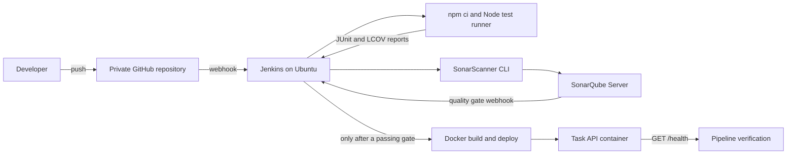
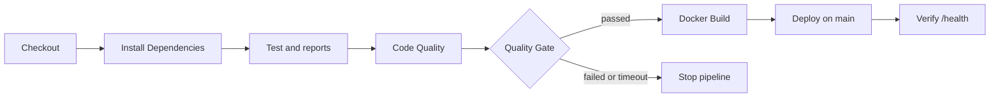

# Task Manager API

A small Node.js REST API and CI/CD demonstration project. Tasks are stored in memory; Express provides the HTTP interface, Node's built-in test runner verifies the endpoints, SonarQube analyzes the source, and Docker packages the app for deployment on Ubuntu.

## Abstract

This project demonstrates a simple path from source control to a running container: push code to GitHub, test it in Jenkins, analyze it with SonarQube, enforce a quality gate, build a Docker image, deploy it on Ubuntu, and verify its health endpoint.

## Problem statement

Without an automated pipeline, application changes can be deployed without repeatable tests, code-quality checks, or a reliable post-deployment health check. This project provides a small REST API as a concrete way to practice those DevOps steps.

## Objectives

- Implement a modular Task Management REST API with input validation and consistent errors.
- Test HTTP behavior using only `node:test`, `node:assert`, and the built-in `fetch`.
- Generate JUnit and LCOV reports using Node's test runner.
- Analyze JavaScript with SonarQube and block deployment on a failed quality gate.
- Build and run a minimal, non-root Docker image.
- Deploy on Ubuntu Linux and verify the live health endpoint.

## Technology stack

| Area | Technology |
| --- | --- |
| Runtime and package manager | Node.js 20+, npm |
| HTTP API | Express.js 5 |
| Source control | Git and a private GitHub repository |
| Automated tests | `node:test`, `node:assert`, built-in `fetch` |
| Code analysis | SonarQube Server and SonarScanner CLI |
| CI/CD | Jenkins Declarative Pipeline |
| Container | Docker |
| Deployment OS | Ubuntu 24.04 LTS (WSL2 or VM) |

No database or third-party test framework is used. The application does not use Java or Maven.

## Architecture



The API uses an in-memory array. Task data is intentionally lost when the process or container restarts.

## API

The default port is `3000`; set `PORT` to change it.

| Method | Path | Purpose | Success |
| --- | --- | --- | --- |
| `POST` | `/tasks` | Create a task | `201 Created` |
| `GET` | `/tasks` | List tasks | `200 OK` |
| `GET` | `/tasks/:id` | Get a task | `200 OK` |
| `PUT` | `/tasks/:id` | Replace task title and description | `200 OK` |
| `PATCH` | `/tasks/:id/complete` | Mark a task complete | `200 OK` |
| `DELETE` | `/tasks/:id` | Delete a task | `204 No Content` |
| `GET` | `/health` | Health check | `200 OK` |

A task contains `id`, `title`, `description`, `completed`, `createdAt`, and `updatedAt`. A non-empty title is required (maximum 120 characters); description is optional (maximum 1,000 characters). Unknown request fields and invalid JSON are rejected. Invalid input or IDs return `400`; a valid but missing task ID returns `404`.

Example:

```bash
curl --fail-with-body --request POST http://localhost:3000/tasks \
  --header 'Content-Type: application/json' \
  --data '{"title":"Write deployment guide","description":"Document the pipeline"}'

curl --fail http://localhost:3000/tasks
curl --fail http://localhost:3000/health
```

## Repository structure

```text
task-manager-api/
├── .dockerignore
├── .gitignore
├── Dockerfile
├── Jenkinsfile
├── package.json
├── package-lock.json
├── README.md
├── sonar-project.properties
├── src/
│   ├── app.js
│   ├── server.js
│   ├── routes/
│   │   └── tasks.js
│   └── services/
│       └── taskStore.js
└── test/
    └── tasks.test.js
```

## Prerequisites

- Ubuntu 24.04 LTS on WSL2 or a Linux VM.
- Node.js 20 or newer and npm.
- Git.
- Docker Engine available to the Ubuntu environment. With Docker Desktop, enable **Settings → Resources → WSL Integration → Ubuntu-24.04**.
- A GitHub account and access to the private repository.
- For the complete pipeline: Jenkins, a reachable SonarQube Server, and a Jenkins URL reachable by GitHub and SonarQube.

The commands below show a per-user Node.js install for Ubuntu x64. The checksum is for Node.js `20.20.2`; use the official Node.js download and matching checksum if choosing another release or architecture.

```bash
mkdir -p ~/.local
cd ~/.local
curl -fLO https://nodejs.org/dist/v20.20.2/node-v20.20.2-linux-x64.tar.xz
echo 'df770b2a6f130ed8627c9782c988fda9669fa23898329a61a871e32f965e007d  node-v20.20.2-linux-x64.tar.xz' | sha256sum -c -
tar -xJf node-v20.20.2-linux-x64.tar.xz
rm node-v20.20.2-linux-x64.tar.xz
echo 'export PATH=$HOME/.local/node-v20.20.2-linux-x64/bin:$PATH' >> ~/.bashrc
source ~/.bashrc

node --version
npm --version
git --version
docker version
```

## Install and run locally

The repository is private. Authenticate with GitHub using your normal Git credential manager or SSH setup; never put a token in the clone URL.

```bash
mkdir -p ~/projects
cd ~/projects
git clone https://github.com/Sangeetha3315/task-manager-api.git
cd task-manager-api
npm ci
npm start
```

The server listens on `0.0.0.0:3000`. To use another port:

```bash
PORT=8081 npm start
```

## Automated testing

All tests use Node's built-in modules and run the Express app on a temporary local port:

```bash
npm test
```

The test runner exits non-zero on failure, so Jenkins stops before analysis, image creation, or deployment. Generate reports with:

```bash
npm run test:report
npm run test:coverage
```

- `test:report` writes `test-results.xml` in JUnit format.
- `test:coverage` writes `coverage.lcov` using Node's built-in LCOV reporter and coverage instrumentation.

Both generated files are ignored by Git and excluded from Docker build context.

## SonarQube

[`sonar-project.properties`](sonar-project.properties) configures the project key, source/test folders, and LCOV report path. The Jenkins **Code Quality** stage runs the SonarScanner CLI; `SONAR_HOST_URL` and authentication are supplied by Jenkins configuration, not stored in this repository.

1. Start a reachable SonarQube Server and create or select the `task-manager-api` project.
2. Create and assign a quality gate to the project. Set the gate conditions appropriate for the selected SonarQube edition and policy.
3. In Jenkins, install/configure the SonarQube Scanner for Jenkins integration and register the server with the name `SonarQubeServer`.
4. Configure the `SonarScanner` CLI as a Jenkins tool. The Jenkinsfile uses these exact names.
5. Add a SonarQube webhook to `https://<reachable-jenkins-url>/sonarqube-webhook/`. This allows `waitForQualityGate` to receive the analysis result.

The pipeline waits up to five minutes for the quality gate. A failed gate or missing/ unreachable webhook fails the build before Docker Build and Deploy. Never commit a SonarQube token; keep it in Jenkins credentials/server configuration.

## Jenkins configuration

The root [`Jenkinsfile`](Jenkinsfile) defines the pipeline:



Configure Jenkins as follows:

1. Run a Jenkins agent on the Ubuntu Docker host with Git, Node.js 20+, npm, and access to the Docker Engine.
2. Install the Jenkins Git, GitHub, Pipeline, SonarQube Scanner, and JUnit plugins.
3. Create a Pipeline-from-SCM or multibranch job for this GitHub repository. Store private-repository credentials in Jenkins and select them in the job configuration; the Jenkinsfile uses `checkout scm`.
4. Configure the SonarQube server and scanner tool names as described above.
5. Configure GitHub push events to `https://<reachable-jenkins-url>/github-webhook/`. Use HTTPS and configure webhook security with the supported Jenkins/GitHub plugin settings; do not put webhook secrets in the Jenkinsfile.
6. Ensure GitHub can reach Jenkins. `localhost` is not reachable from GitHub; use an appropriately secured, reachable HTTPS endpoint.

Tests, code analysis, and Docker Build run before deployment. Deploy and Verify run only for `main`. Jenkins publishes `test-results.xml` as a JUnit report. The pipeline builds and deploys on the same agent, so use the Ubuntu host that owns the target Docker Engine.

## Docker

Build and run the image from the repository root:

```bash
docker build --tag task-manager-api:local .
docker run --detach \
  --name task-manager-api \
  --restart unless-stopped \
  --publish 3000:3000 \
  task-manager-api:local
```

The image uses the official Node 20 Alpine image, installs locked production dependencies with `npm ci`, runs as the non-root `node` user, and includes a Docker health check for `/health`.

Inspect and operate the container:

```bash
docker ps
docker inspect --format '{{.State.Status}} {{.State.Health.Status}}' task-manager-api
docker logs --tail 50 task-manager-api
curl --fail http://localhost:3000/health
docker restart task-manager-api
curl --fail http://localhost:3000/health
```

The data store is in memory, so a restart clears all tasks. To replace the container after rebuilding, stop and remove the old container before running the new image with the same name and port.

## Ubuntu / WSL2 deployment

From Windows PowerShell, install and start Ubuntu 24.04 if needed:

```powershell
wsl --install -d Ubuntu-24.04
wsl -l -v
wsl -d Ubuntu-24.04
```

Complete Ubuntu's first-run user setup, enable Docker Desktop WSL integration for `Ubuntu-24.04`, then work under the Linux home directory (for example, `~/projects/task-manager-api`) rather than `/mnt/c`.

Inside Ubuntu, clone the repository, install dependencies, run the tests, build, and deploy:

```bash
cd ~/projects/task-manager-api
npm ci
npm test
docker build --tag task-manager-api:local .
docker run --detach \
  --name task-manager-api \
  --restart unless-stopped \
  --publish 3000:3000 \
  task-manager-api:local

docker ps
docker logs --tail 50 task-manager-api
curl --fail http://localhost:3000/health
docker restart task-manager-api
curl --fail http://localhost:3000/health
```

The current demonstration was built from `/home/rita/projects/task-manager-api` in Ubuntu 24.04 under WSL2. Its `task-manager-api` container was healthy on port 3000 and recovered after a restart.

## Verification results

| Check | Result |
| --- | --- |
| Node.js in Ubuntu | `v20.20.2` |
| npm in Ubuntu | `10.8.2` |
| `npm ci` | Passed |
| `npm test` | 9 tests passed, 0 failed |
| JUnit test report | Generated by `npm run test:report` |
| LCOV coverage | Generated by `npm run test:coverage` |
| Docker image build | Passed (`task-manager-api:phase6`) |
| Container runtime | Non-root `node`, port 3000, health `healthy` |
| Health and task API smoke checks | Passed |
| Container restart check | Passed; `/health` returned `{"status":"ok"}` after restart |

The GitHub repository is private and the source has been pushed to `main`. The SonarQube analysis/quality-gate run, Jenkins run, and GitHub webhook delivery still require a configured SonarQube server and reachable Jenkins endpoint; they have not yet been claimed as verified.

## Screenshots checklist

- [ ] `wsl -l -v` showing Ubuntu 24.04 on WSL2.
- [ ] Passing `npm test` output and the JUnit report.
- [ ] SonarQube project dashboard and passing quality gate.
- [ ] Jenkins build showing all stages, including Quality Gate, Deploy, and Verify.
- [ ] Private GitHub repository and successful webhook delivery.
- [ ] Docker image, healthy container, logs, and successful post-restart health check.

## Conclusion and future enhancements

This project demonstrates a complete application-to-container workflow with automated tests, static analysis configuration, gated deployment, and a verified Ubuntu container. The API intentionally favors simplicity over persistence or authentication.

Possible future enhancements include persistent storage, authentication, pagination, structured logging, and deployment to a managed container host. These are intentionally outside the current minimal scope.
